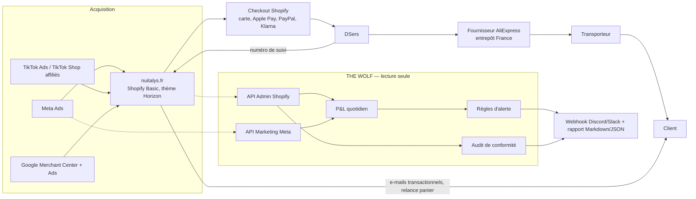

# Architecture technique

## Vue d'ensemble

## Composants

| Composant | Rôle | Outil | Coût mensuel | État |
|---|---|---|---|---|
| Boutique | Catalogue, pages, paiement | Shopify Basic | 36 € (27 € en annuel), TVA autoliquidée à ajouter | En ligne |
| Exécution des commandes | Commande fournisseur, suivi | DSers (plan gratuit) + AliExpress | 0 € | En place côté boutique, non audité (pas d'accès DSers) |
| E-mails | Confirmation, expédition, relance panier, avis | Shopify Email (10 000 e-mails/mois gratuits) | 0 € | Relance panier à activer |
| Avis clients | Collecte d'avis **réels** après livraison | Judge.me gratuit | 0 € | À installer |
| Consentement cookies | Bannière conforme CNIL | Bannière Shopify native ou Pandectes (dès 9 $) | 0 à 9 $ | À vérifier |
| Mesure | Pixel Meta + API Conversions, TikTok Pixel, Google | Canaux Shopify officiels | 0 € | TikTok et Google installés ; Meta à installer |
| Pilotage | P&L, audit, alertes | THE WOLF (`wolf/`, Node 22, TypeScript) | 0 € | Code testé, en attente du jeton |
| Planification | Exécution quotidienne | GitHub Actions (modèle `ops/github-actions/wolf-daily.yml`) | 0 € (quota gratuit) | Modèle prêt, inactif |

## Flux de données de THE WOLF

1. `src/shopify/client.ts` interroge l'API Admin GraphQL (version `2026-10`) avec un jeton d'app personnalisée **en lecture**.
   Réessais automatiques sur 429, 5xx et `THROTTLED`, délai exponentiel.
2. `src/shopify/snapshot.ts` construit un instantané (produits, variantes, coûts, poids, tarifs de livraison avec seuils, pages).
3. `src/audit/storeAudit.ts` contrôle la cohérence de la promesse et de la caisse, la GPSR, les pages légales, les prix barrés,
   le vocabulaire thérapeutique, les coûts et poids manquants.
4. `src/pnl/daily.ts` transforme commandes, entonnoir ShopifyQL et dépenses publicitaires en P&L par jour.
5. `src/monitoring/rules.ts` évalue les règles d'alerte ; `src/pnl/report.ts` produit le rapport.
6. `src/cli/report.ts` écrit `out/report-<date>.md|json`, journalise l'exécution dans `out/runs.log` et envoie les alertes au webhook.

Les seuils (CPA maximal, ROAS de rentabilité) ne sont pas saisis à la main : ils sont **recalculés** depuis l'économie unitaire
de l'offre principale (`config/alerts.json` → `heroOfferId`). Si le coût fournisseur change, les alertes suivent.

## Sécurité et données personnelles

- Moindre privilège : droits Shopify en lecture seule, droit Meta `ads_read` uniquement. Aucun script n'écrit dans la boutique.
- Secrets dans `.env` (ignoré par git) ou dans les secrets GitHub Actions. Jamais dans le code, les journaux ni les rapports.
- RGPD : THE WOLF ne stocke **aucune donnée client nominative** ; les rapports ne contiennent que des agrégats journaliers.
- Le jeton Meta passe dans l'en-tête `Authorization`, jamais dans l'URL (pour ne pas fuiter dans les journaux).

## Sauvegarde et reprise

| Risque | Prévention | Reprise |
|---|---|---|
| Thème cassé après une modification | Dupliquer le thème avant toute modification | Republier la copie précédente (Boutique en ligne > Thèmes) |
| Produit ou page supprimé | Export CSV hebdomadaire des produits ; pages et politiques archivées dans `docs/` | Réimport CSV ou republication |
| Jeton révoqué ou expiré | Le rapport s'arrête avec un code d'erreur et une ligne `error` dans `out/runs.log` | Recréer le jeton, mettre à jour le secret, relancer `npm run report` |
| Version d'API Shopify retirée | Version explicite `SHOPIFY_API_VERSION` | Monter la version, relancer `npm test` et `npm run audit` |
| Synchronisation DSers en panne | Alerte `FULFILLMENT_DELAY` au-delà de 48 h | Passer les commandes à la main dans DSers, prévenir les clients concernés |
| Fournisseur défaillant (rupture, délais, qualité) | Deux fournisseurs identifiés par produit avant de monter le budget | Remapper la variante dans DSers vers le fournisseur de secours |

## Évolution vers plusieurs boutiques

La configuration est déjà séparée du code (`config/*.json`). Pour une deuxième boutique : un dossier de configuration par boutique,
un jeton par boutique, la même chaîne de rapport. Pas de base de données tant que le volume ne le justifie pas :
les rapports JSON quotidiens suffisent comme historique jusqu'à quelques milliers de commandes.
